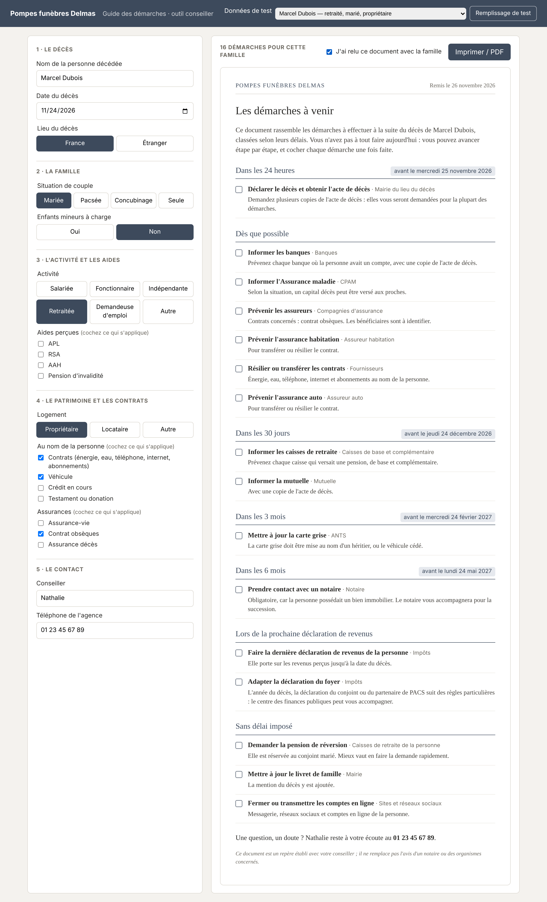

# Guide des démarches · Pompes funèbres Delmas

Prototype réalisé pour le TP « Stratégie IA » (B3 DEV, dossier 5).

Pendant l'entretien, le conseiller répond avec la famille à 12 questions : lieu du décès, couple, enfants mineurs, activité, aides, logement, contrats, véhicule, crédits, assurances, testament et date du décès. L'outil sélectionne parmi 28 démarches celles qui s'appliquent, les regroupe par délai (24 h, 48 h, dès que possible, 30 jours, 3 mois, 6 mois, déclaration de revenus, sans délai, si nécessaire), calcule les dates limites à partir de la date du décès et produit un document sobre à imprimer et à remettre à la famille.

Les démarches toujours présentes, quelle que soit la situation, sont la mairie (ou le consulat), les banques, la CPAM, la mutuelle, les impôts et les comptes en ligne.



## Lancer

Aucune installation, aucune clé d'API. Il suffit d'ouvrir `index.html` dans un navigateur.
Le menu « Données de test » charge les 4 cas vérifiés à la main. Le bouton **Remplissage de test** remplit tout le formulaire avec une situation fictive tirée au hasard, différente à chaque clic (`situationAleatoire()` dans `src/demarches.js`).

Tests du moteur de règles (Node 18 ou plus) :

```bash
node --test tests/*.test.js
```

## Choix techniques

| Choix | Pourquoi |
|---|---|
| **Moteur de règles** (arbre de décision codé à la main) plutôt qu'un LLM | Les démarches et leurs conditions sont connues et finies (guide interne). Un modèle génératif n'apporterait rien et ferait courir un risque sur le ton ou les délais. |
| **Textes rédigés et validés à l'avance** | Aucun mot n'est généré à la volée, donc aucune erreur de ton n'est possible. |
| **100 % local**, aucun appel réseau | Les données sont très personnelles et rien ne quitte le poste du conseiller. |
| **Case « J'ai relu ce document avec la famille »** obligatoire avant l'impression | L'humain garde la main. |

## Structure

```
index.html            écran du conseiller
src/demarches.js      données (28 démarches, 9 délais) et moteur de règles : selectionner(), grouper(), valider()
src/cas-de-test.js    4 situations de test avec le résultat attendu (vérifié à la main)
src/app.js            interface : saisie, affichage, impression
src/style.css         styles écran et impression
tests/                tests automatiques (node:test)
```

## Limites connues

- Seuls les délais du dossier sont sourcés (24 h, 48 h, 30 jours, 3 mois, 6 mois). Les autres démarches sont classées « dès que possible » ou « sans délai imposé », et doivent être validées par un juriste avant la mise en service.
- Une seule activité peut être choisie, alors qu'une personne peut par exemple être retraitée et indépendante.
- Les règles de couple sont simplifiées : la réversion et le livret de famille ne concernent que le mariage, la déclaration du foyer le mariage et le PACS. Les situations de divorce ou de remariage ne sont pas couvertes.
- Si une case n'est pas cochée, la réponse est considérée comme « non » : un oubli fait disparaître une démarche, d'où la relecture obligatoire.
- Pas d'enregistrement : rien n'est stocké, ce qui est voulu pour la confidentialité mais empêche tout suivi ou rappel.
- Pas de version anglaise ni d'autres langues.
